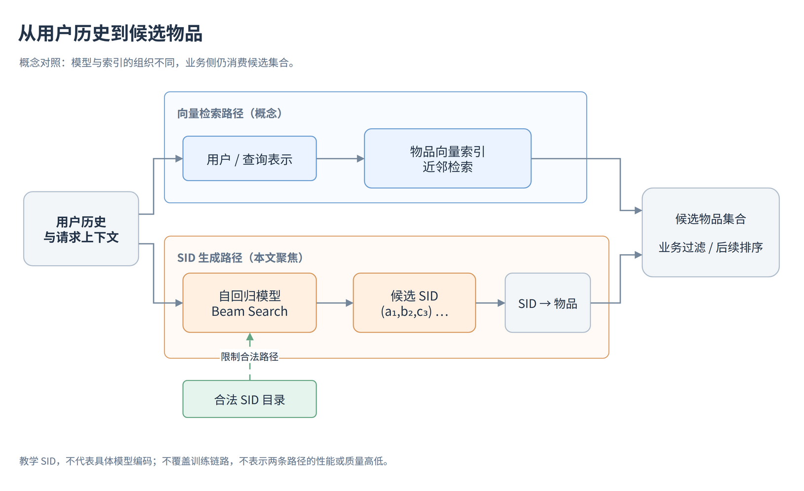
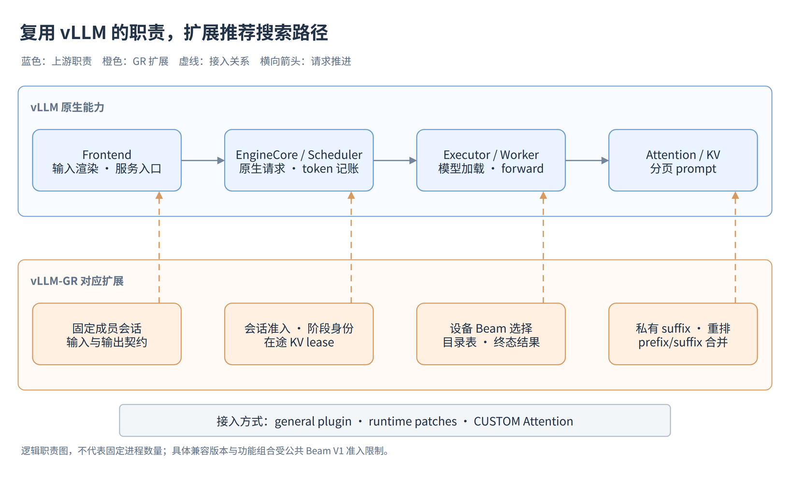
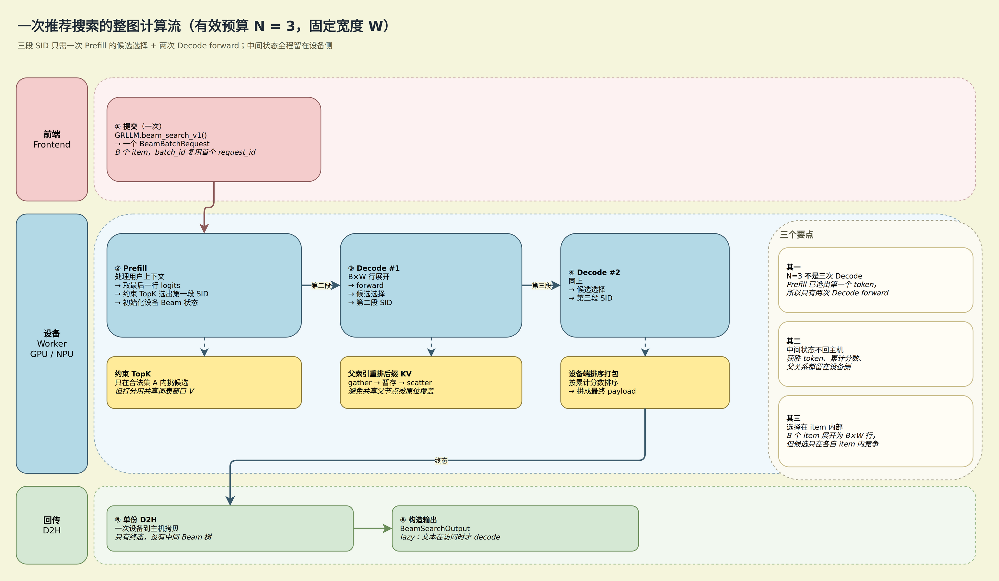
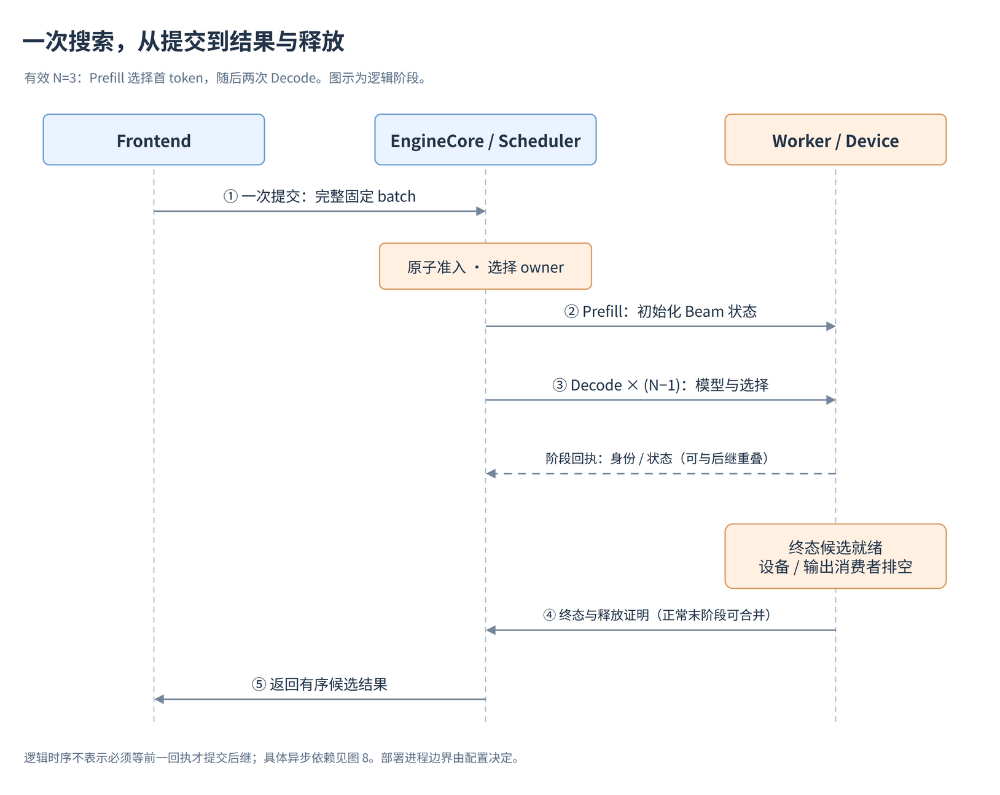
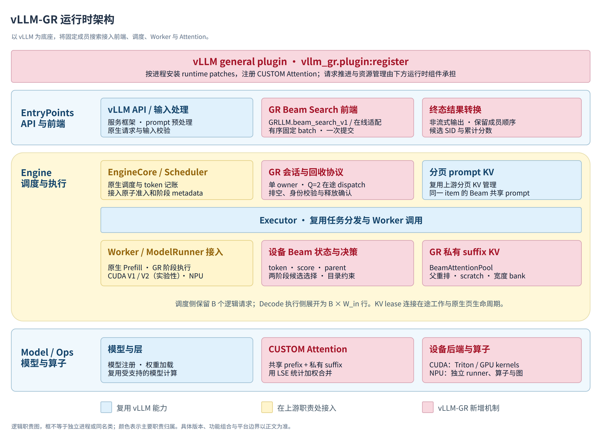
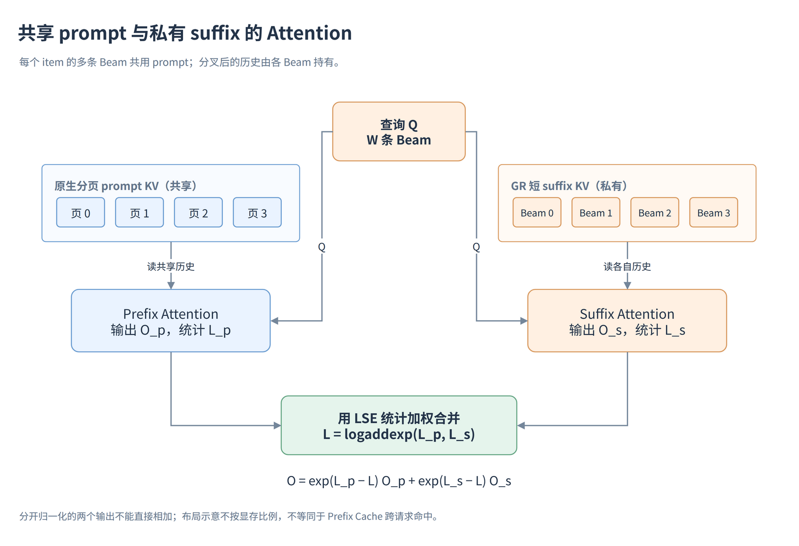
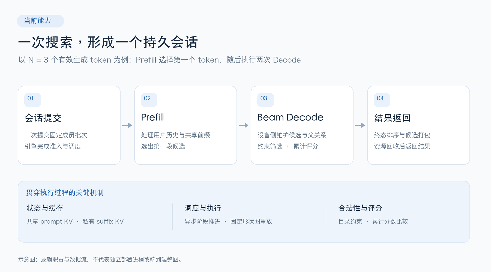
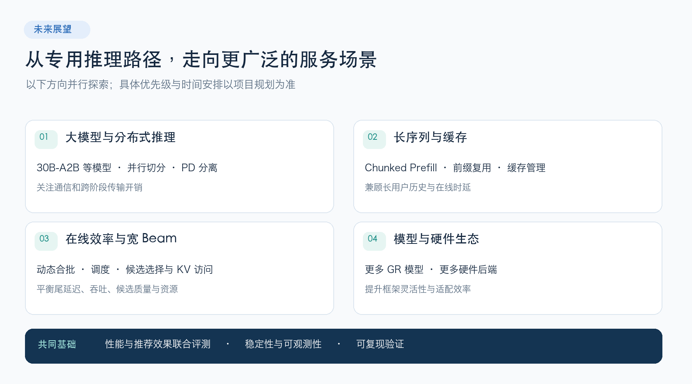

# vLLM-GR低时延生成式推荐推理系统

> 介绍 vLLM-GR 低时延生成式推荐推理系统的整体架构、推理引擎、调度并发、缓存加速、竞品性能和后续规划。

- 日期：2026-10-27
- 标签：vLLM-GR、recommendation、performance

---

## 1 背景与挑战

推荐系统的核心任务没有变过：给定一个用户的交互历史，从巨大的物品库中选出少量候选。变化的是"怎么找"。

过去十余年，这件事主要由检索与排序两段流水线完成，其中召回环节长期由向量检索主导——把用户或查询编码成向量，在物品向量索引中寻找近邻。近几年兴起的生成式推荐换了一条路：把物品编码成若干段语义 ID（Semantic ID，SID），让模型根据用户上下文**逐段生成**候选物品的标识，再把标识映射回业务物品。这一方向可追溯到 *Recommender Systems with Generative Retrieval* 等工作，该文用 Semantic ID 表达物品并以自回归方式生成候选，见 [论文](https://arxiv.org/abs/2305.05065)。

本文只讨论这套范式中的**推理**环节：给定用户历史，生成一批候选 SID 及其分数。语义码构建、模型训练与业务排序各有职责，不在本文范围。

### 1.1 推荐系统的三代演进

要理解为什么生成式推荐会带来完全不同的推理需求，先看它接替的是什么。

| 代际 | 时间 | 技术底座 | 核心建模方式 |
| --- | --- | --- | --- |
| 第一代：线性模型推荐 | 2010 起 | 大数据/数据挖掘时代的广义线性模型、树模型 | 基于逻辑回归、矩阵分解、树模型建模特征间的线性关系与浅层非线性关系 |
| 第二代：深度学习推荐（DLRM） | 2015 至今，当前主流 | 深度学习 | ① 用深度模型**自动**建模特征间的深度非线性关系；② 基于长序列检索结合浅 Transformer 建模用户行为 |
| 第三代：生成式推荐 | 2024 起，探索应用 | Transformer | ① **生成式全序列建模**：用生成式架构做全序列细粒度建模，减轻传统搜推系统的特征工程；② **生成式多模态融合建模**：以 LLM / MLLM 为底座，对用户行为模态与物品多模态信息联合建模 |

三次跃迁的驱动力各不相同：第一代到第二代是**特征学习**赋能推荐；第二代到第三代则是**知识学习 + Scaling Law** 赋能推荐。

这个演进脉络解释了一件重要的事：**前两代的工程重心在"特征"，第三代的工程重心在"序列和模型"**。当模型变成一个大 Transformer、输入变成数千个 token 的行为序列时，推理系统的设计假设就整个换了。

### 1.2 2025：产业界的集体转向

2025 年是生成式推荐从论文走向业务的一年。据公开分享材料统计，互联网公司当年发布了 15 个以上生成式推荐模型。时间线大致如下：

```text
2024.02  Meta HSTU          —— 早期工业界生成式推荐尝试
2025.02  阿里 LUM / 网易 Climber
2025.05  字节 LONGER / 百度 GRAB / 美团 MTGR
2025.06  阿里 GPSD / 快手 OneRec-V1 / 字节 RankMixer
2025.08  快手 OneRec-V2 / 华为 Fuxi-β / Meta ROO 数据格式
2025.10  字节 OneTrans / 谷歌 PLUM
2025.11  Meta GEM / Meta SilverTorch / 快手 OneRec-Think
```

> 以上时间与数字来自各公司的公开分享材料。各家统计口径、测试负载与对照基线并不一致，**不能横向直接比较**；本节引用它们是为了说明趋势与量级，不作为性能结论。

这些工作共同呈现出三个趋势：

**其一，复用语言模型的建模思路，把 Scaling Law 带进搜推广。** 当前最大的生成式推荐模型已做到 10B 量级（如快手 8B 模型）。这与第二代 DLRM 的参数量完全不在一个数量级。

**其二，用户行为序列越做越细。** 模型输入序列已经做到 2K～3K 量级（如字节的相关工作），而第二代的序列建模通常只有几百。

**其三，出现"基于语言模型持续训练"的新范式。** 快手基于 Qwen-8B、谷歌基于 Gemini 做继续预训练和领域微调，而不是从零训练一个推荐模型。

#### 几个代表性案例

**快手 OneRec 系列。** OneRec-V1 采用 Encoder-Decoder 架构，序列长度 512，语义 ID 为 1:3，训练与推理 MFU 分别为 23.7% 和 28.8%。OneRec-V2 改为 Decoder-only，参数 0.1B～8B，序列长度提升到 3K；其中 1B 模型在 3K 序列下的在线推理使用 L20（FP16 119.5 TFLOPS），MFU 62%，时延 36ms。OneRec-Think 则基于 Qwen-8B 做持续预训练，用"Think-Ahead"两阶段架构把语义 ID 生成拆成离线与在线两段。

**字节 LONGER / RankMixer / OneTrans。** 这三个工作有一个共同的工程主题：**把 MFU 提上去**。RankMixer 通过面向硬件友好的统一可扩展特征交互架构，把模型 MFU 从 4.5% 提升到 45%，参数量提升 100 倍，而推理时延保持在 14.3ms。OneTrans 用 Decoder-only 加 Pyramid Stack、Cross-Request KV Caching 与 FlashAttention，训练 MFU 从 13.4% 提升到 30.8%，推理时延 13.2ms。

**谷歌 PLUM。** 以 Gemini-1.5 为基座（MoE-4.2B-A0.9B），1.5K 序列覆盖约最近 100 次观看行为。它的关键工程点在于**语义 ID 与语言模型词表的对齐**：用多模态物品信息与协同信息生成物品语义 ID，再用 260B token 的推荐语料做继续预训练（用户行为与物料文本描述各占 50%）。据其分享，训练成本降到基线的 0.55 倍，多个 YouTube 场景线上效果最多 +4.96%。

**Meta HSTU / GEM / SilverTorch。** HSTU 是较早的工业界生成式推荐实现，序列 1K，在线 A/B 测试有 12.4% 的指标提升。GEM 的规模叙事更直接：使用比传统模型多 16 倍以上的 GPU，模型算力利用率提高 1.43 倍。而 **SilverTorch 值得单独一提**——它把推荐系统传统的在线服务流水线从 CPU 服务整体迁移到 GPU 上的统一模型执行框架，延迟降低最多 5～6 倍，吞吐提高最多约 23.7 倍，成本效率提升约 13.35 倍。

SilverTorch 的方向与本文主题高度相关：**推荐系统的瓶颈正在从"模型不够大"转向"服务框架不适配"**。

### 1.3 算力平台面临的两个硬约束

上面这些模型要真正上线，还要过算力平台这一关。业界分享中反复提到两条约束：

**第一，工业级推荐系统在训练与服务阶段都必须满足严格的低时延要求和高 QPS。** 推荐是在线链路，一次请求的预算通常是毫秒级，而且要在每秒大量查询下稳定成立。这与"离线跑一个 benchmark 就够"的研究场景完全不同。

**第二，大量算力被低效的模块吃掉。** 大多数排序模型中人工设计的特征交叉模块源自 CPU 时代，难以充分利用现代 GPU，导致模型算力利用率（MFU）低下、扩展性有限。

第二条约束解释了为什么上面几个案例都在强调 MFU：LONGER 把推理吞吐的下降从 −40% 收敛到 −6.8%，RankMixer 把 MFU 从 4.5% 提到 45%，OneTrans 把训练 MFU 从 13.4% 提到 30.8%。**这些数字本质上都是在说：同样的 GPU，之前的框架用不好。**

### 1.4 生成式推荐带来的推理负载变化

把前面的趋势收敛到推理侧，会得到一类与传统对话服务明显不同的负载。它的三个特征组合在一起，才构成真正的难点。

**上下文较长，有效输出极短。** 一条 SID 只有三段，按 token 计不过几个；而用户行为上下文可以是几千 token。一次搜索的计算结构是：

```text
1 次 Prefill 的候选选择 + (N−1) 次 Decode forward
```

其中 N 是有效生成 token 数，**包含** Prefill 选出的第一个 token。所以 N=3 时只有两次 Decode，而不是三次。输出短意味着每次调用的固定开销占比被放大：初始化、请求编排、结果物化的成本，未必能被长时间的 Decode 摊薄。

**候选分支很多。** 只保留每步概率最高的 token 会得到一条路径，而召回需要一组候选，因此要保留多个前缀。Beam Search 每步保留 W 条候选前缀，扩展后再按累计分数筛选。搜索宽度 W 与最终返回数量 R 是两个概念：可以保留较宽的搜索空间，只返回其中较少的候选。工业场景里 W 常取 128～256 这个量级。

**候选必须合法。** 并非任意三个 token 都能组成目录中的物品。`(a₁,b₂,c₉)` 若没有对应条目就必须在搜索中排除。合法性判断、模型评分、业务映射是三个相互关联又不可混淆的环节。



*图 1：向量检索与 SID 生成的概念对照。图中 SID 为教学标识，图形大小不表示成本。*

三个特征叠加起来，就是一句概括：**长上下文 + 短解码 + 大 Beam**。这正是通用 LLM 推理框架最不适配的组合——它们优化的是"多用户请求、动态批处理、长解码、OpenAI 风格 API"。



*图 2：上层为复用的 vLLM 职责，下层为对应的 GR 扩展。这是逻辑职责图，不是固定部署进程图。*

### 1.5 现有推理路径的三个挑战

#### 挑战一：主机与设备之间的往返次数随宽度增长

vLLM 本身已提供 Beam Search。其离线实现采用前端循环：每轮以单 token 生成方式调用引擎，取回 top-`2W` 的 logprobs，在前端扩展 Python Beam 对象、累计分数并排序，再进入下一轮。核心代码在 `vllm/entrypoints/generate/beam_search/offline.py`：每次 decode 都构造一个新的 `SamplingParams(logprobs=2*beam_width, max_tokens=1)` 请求，W 条 beam 各自作为独立请求提交。

这条路径的接口很清楚，但对"反复执行短输出、大候选集"的负载，请求次数是 `1 + (N−1)·W`：第 1 步只有一条 beam，此后每步 W 条。N=3、W=32 是 63 次请求往返，W=256 则是 511 次。**往返次数随 W 线性放大**，而每次往返只换来一个 token 的信息量。

#### 挑战二：搜索状态放在哪里

Beam 的中间状态包括候选 token、累计分数与父关系。上游实现把这些状态全部放在 Python 前端对象里（`BeamSearchSequence` / `BeamSearchInstance`），每步重新构造完整父序列作为新 prompt 提交。这意味着每步都要重算前缀——即使 Prefix Cache 命中省掉了部分计算，请求边界和 KV 生命周期仍逐请求建立和回收。

状态放前端的好处是通用、易改；代价是中间 Beam 树反复进出主机，且不同 beam 之间无法在同一执行上下文里协同。对于需要同时维护数百条路径的场景，这个组织方式的固定开销会持续累积。

#### 挑战三：约束与评分的语义容易混淆

目录合法的候选不一定在正确的概率域里被比较。若把非法 token 屏蔽后重新归一化，会定义出另一个条件分布：某个父前缀只有一个合法后继时，该后继的局部 logprob 恒为 0，即使模型本来更倾向其他 token。这会直接改变候选排序。

因此"哪些 token 合法"和"如何比较这些 token 的分数"必须是两个可分别验证的契约，不能简单合成一次 mask 操作。

### 1.6 vLLM-GR 的应对思路

vLLM-GR 基于 vLLM 构建，但**不是 fork**：它通过 general plugin、运行时补丁与 CUSTOM Attention 接入现有引擎，复用模型加载、原生 Prefill、分页 KV 与调度记账，把三项新职责补齐：

1. **持久 Beam 执行** —— 把一次搜索作为会话接入引擎，候选 token、累计分数与父关系留在 Worker/设备侧，阶段之间只传递必要的控制信息。
2. **共享 prompt、私有 suffix 的 KV 组织** —— 多条 Beam 复用原生分页 prompt KV，分叉后的短后缀由 GR 单独管理，Attention 用 log-sum-exp 统计正确合并两部分贡献。
3. **显式的目录与评分契约** —— 把合法关系编译成设备可用的约束表，与 tokenizer 绑定；评分在统一词表域内进行，再把候选限制到合法集合。

这三项设计的目标是减少反复的主机编排、管理大 Beam 下的共享与私有状态。**它们不构成性能承诺**：收益取决于 Prefill、模型 forward、候选选择与排队各自的实际占比，必须由具体负载的 profile 决定，不能凭结构差异直接推断倍率。

复用上游也带来明确的维护成本：部分扩展依赖上游内部接口，版本兼容需要由契约测试和真实启动验证支撑。第 2 章展开整体架构，第 3 章起分别讨论引擎、调度与缓存的具体设计。

## 2 低时延生成式推荐推理系统 vLLM-GR

vLLM-GR 是一个基于 vLLM 的生成式推荐推理引擎，当前聚焦 OneRec 类模型的 SID 候选生成路径，同时保留普通 LLM 的 `generate()` 直通能力。二者是两条独立路径，能力不可相互外推。

本章先给出一次搜索的计算全景，再说明系统由哪些层组成、各自复用上游还是新增了什么。

### 2.1 整图计算流

以有效预算 N=3、固定宽度 W 为例，一次完整的推荐搜索如下。




*图 2：三段 SID 的完整计算路径。粉色为前端提交与输出、蓝色为设备侧执行、黄色为选择与 KV 重排、绿色为回传。外层灰色虚线框是三个逻辑层次，不代表进程边界。*

需要强调三点：

**其一，N=3 不是三次 Decode。** Prefill 已经在最后位置选出第一个 token，因此只有两次 Decode forward。如果接口还包含 begin/end 标记，它们与有效 SID token 的预算关系需要单独处理，不能把所有返回标记都算成设备执行的 Decode 步数。

**其二，中间状态不回主机。** 每一轮 Decode 结束后，真正获胜的 token、累计分数与父关系都留在设备侧。回传的只是紧凑控制信息（阶段身份、几何、完成状态），终态才做一次设备端排序打包和单次 D2H。

**其三，选择发生在同一个 item 内部。** B 个逻辑请求展开为 B×W 个物理执行行，但候选只在各自 item 内竞争；第二个用户不会因为第一个用户分数更高而丢失全部 Beam。父索引也在各 item 内解释。



*图 3：同一会话中的 Prefill、两次 Decode 与终态回收。阶段回执是控制信息；正常最后阶段可以合并终态候选与释放证明。图中责任主体是逻辑角色，实际进程部署由 Executor 等配置决定。*

这条链路相对上游 Beam 的关键变化，在于**调用边界**：

| 环节 | upstream vLLM | vLLM-GR |
| --- | --- | --- |
| 引擎请求数 | `1 + (N−1)·W` | 1（一次会话） |
| Beam 状态位置 | Python 前端对象 | Worker / 设备 |
| 前缀计算 | 每步重新 Prefill | 一次 Prefill + 后缀 |
| 中间结果 | top-2W logprobs 全量回主机 | 紧凑控制信息 |
| 候选选择 | 前端 Python 排序 | 设备端算子 |

### 2.2 总体架构

系统可以按"复用 / 接入 / 新增"三类职责理解。这个划分很重要：它解释了哪些行为可以按 vLLM 的文档来理解，哪些必须查 GR 自己的契约。



*图 4：从 EntryPoints、Engine 到 Model / Ops 的逻辑职责图。蓝色表示复用 vLLM，黄色表示在上游职责处接入，粉色表示 GR 新增机制。顶部 plugin 在启动时安装扩展；图中分组不代表独立进程，也不要求存在同名 Python 类。*

#### 复用层（蓝色）

模型权重加载、原生 Prefill、分页 KV 管理、调度记账、请求与响应协议都走上游实现。GR 不重写这些能力，因此上游在模型支持、量化方案、并行策略上的演进大部分可以直接继承。

#### 接入层（黄色）

通过 `vllm.general_plugins` 入口注册，vLLM 在 **main / EngineCore 子进程 / Worker 子进程**中各自执行一次，所以初始化必须幂等。启动链路是：

```text
插件入口 → ModelRunner 默认 → 版本闸门 → 补丁链 → 约束表加载 → 图捕获
```

两处细节值得单独说明：

- **ModelRunner 默认值。** vLLM 0.22 会对部分模型（如 Qwen3）自动启用 ModelRunner V2，绕过 GR 的 V1 worker 补丁并可能**静默产生错误的 Beam 结果**。GR 在配置构建前将未设置的开关置为 0；显式设置 V2 仍作为实验路径保留。
- **版本闸门。** 补丁针对上游私有符号，因此启动时校验 vLLM 版本，不匹配直接拒绝启动。版本号一致并不等于私有接口兼容——GR 文档记录的基线与本机 HEAD 就不是同一提交。

每个运行时补丁都必须登记在补丁清单中（owner、安装器、目标符号、进程角色、风险、移除条件），并配有契约测试。补丁是否已安装、目标方法是否符合预期，都会影响引擎能否进入可服务状态。

#### 新增层（粉色）

- **会话提交与阶段 metadata**：前端一次提交，EngineCore 完成准入与阶段推进，调度器不会看到半个批次。
- **Worker Beam 决策**：候选展开、累计分数选择、父索引重排。
- **私有后缀 KV 与 Attention 合并**：共享 prompt 走原生分页 KV，分叉后的短历史进 GR 自己的池。



*图 5：同一个 item 的多条查询读取一份分页 prompt 和各自的短 suffix，分别计算 Attention 后用 LSE 合并。箭头表示读取与计算依赖，区域大小不表示内存比例。*

图中三类状态是分开放的：原生分页 KV 保存共享 prompt，设备 Beam 状态保存候选 token、分数与父关系，GR 私有 suffix KV 保存分叉后的历史。它们通过阶段 metadata、父重排和资源回收协议协作。

### 2.3 当前能力边界

以下是代码层面的准入约束，不是全部设备上的实测结果。

| 项目 | 当前范围 |
| --- | --- |
| 请求形态 | 调用方组成固定成员 batch，返回最终候选集合 |
| 批次与宽度 | B=1..8，W=1..256，请求需匹配引擎配置 |
| 生成预算 | 固定有效预算；canonical 约束路径 N≤3 |
| 执行 | 单执行 owner，Q=2 在途 dispatch |
| 停止 | 要求 `ignore_eos=True`，按长度结束 |
| 并行 | TP/PP/DP/DCP/PCP 均为 1 |
| Prefill | 需完整完成剩余 prompt，拒绝 chunked / partial |
| 功能组合 | 拒绝量化、LoRA、多模态、hybrid、speculative、KV/EC transfer、microbatching |
| 平台 | CUDA 主线；NPU 有独立适配，CUDA ModelRunner V2 为实验性 |

固定 batch 不等于跨请求自动合批。在线 completions 可以把策略允许的 prompt 列表组成一个会话，但多个独立 HTTP 请求自动加入同一执行 batch 属于另一层准入设计，当前不做。

这些边界属于 GR 持久 Beam 路径，**不能外推为整个 vLLM 的限制**。普通 `generate()` 直通路径不受这些约束。

### 2.4 本章小结

vLLM-GR 的核心取舍可以概括为一句话：**用设备端持久状态换掉每步 W 次主机往返**。

这样做的收益取决于原本主机编排占多少时间，代价则是一组更紧的准入约束和明确的版本绑定关系。后续三章分别展开这三块：

- 第 3 章讨论推理引擎本身：Beam Search 优化、整图优化、候选集优化；
- 第 4 章讨论调度与并发：轻量化框架与并行调度；
- 第 5 章讨论池化加速：两级 KV 组织，以及 GPU / NPU 共用的后缀池契约。

## 3 低时延推理引起GR-Engin

```text
// 田晓冬
可从beam search优化、 整图优化、候选集优化等方面着重写
```

## 4 调度与并发优化 GR-Scheduler

生成式推荐通常只需生成几段 SID，却要同时维护几十到几百条 Beam。生成步数短、候选规模大，使请求组织、状态传递和阶段切换成为影响响应时延的重要因素。

GR-Scheduler 面向这一特点，将完整搜索组织为一次持续驻留的推理会话：**前端一次提交，设备持续维护候选，CPU 与 GPU 协同推进，完成后统一返回结果。** 框架通过轻量化控制链路、阶段流水、批量执行和资源生命周期管理，减少搜索过程中的主机往返与等待。

### 4.1 轻量化调度：让搜索状态留在引擎内

一次推荐搜索包含上下文处理、候选扩展、分数累计和最终选择。GR-Scheduler 将这些步骤放在同一会话中推进。前端负责输入和结果交付，Worker 在设备侧维护 Beam token、累计分数、父子关系和分叉后的 KV 状态；阶段之间传递紧凑控制信息，最终候选在搜索完成后统一物化。

![GR-Scheduler 的分层职责与会话内流水][gr04-ownership]

*图 4-1：前端提交固定成员的会话，调度层管理逻辑请求，Worker 执行展开后的 Beam 行。分层表示逻辑职责，实际进程划分由执行器配置决定。*

| 设计 | 实现方式 | 对推荐推理的价值 |
| --- | --- | --- |
| 一次会话提交 | 一组 prompt 作为完整搜索任务进入引擎 | 减少前端逐轮组织和提交候选的开销 |
| 设备持久状态 | 中间 token、分数、父索引和 suffix KV 保留在设备 | 减少中间结果回传与主机参与 |
| 原生调度复用 | 复用 vLLM 的请求管理、token 记账、KV 分配和执行队列 | 沿用统一的资源管理机制，Beam 扩展集中在会话与执行层 |
| 逻辑与物理执行分离 | 调度器管理 B 个逻辑请求，Decode 执行 B×W 个 Beam 行 | 将候选并行交给设备批量计算，控制层保持清晰的请求边界 |

例如，B=4、W=128 时，每轮 Decode 在原生调度器中推进 4 个逻辑 token，设备实际执行 512 个 Beam 行。候选只在各自请求内竞争，成员顺序在整个搜索过程中保持一致。

### 4.2 异步流水：重叠 CPU 准备与 GPU 计算

生成下一段 SID 需要上一阶段的候选结果，但下一阶段的部分准备工作——位置、长度、KV block 映射和 attention metadata——可以提前完成。GR-Scheduler 利用这一点，将下一阶段的 CPU 准备安排在当前阶段的 GPU 执行窗口内。

以生成 3 段 SID 为例，Prefill 已产生第一段，随后只需两次 Decode：

1. **提交当前阶段。** Worker 将 Prefill Forward、首次候选选择和状态更新依次提交到设备。
2. **提前准备下一阶段。** 在途槽允许时，CPU 开始准备 Decode 1 的输入布局和元数据，无需先将候选完整读回主机。
3. **按依赖执行设备工作。** 实际 token 和 Beam 状态的绑定排在前一阶段采样之后；前驱就绪后，设备继续执行 Decode。控制回执被消费后，在途槽可供后续阶段使用。

![串行执行与异步阶段流水的时序对比][gr04-overlap]

*图 4-2：示意时间轴。异步路径将下一阶段的 CPU 准备移入当前 GPU 计算窗口；设备上的生成依赖仍按序执行。图中宽度不代表实测时长。*

框架使用两个在途槽推进同一会话。输入暂存区和控制快照分别由数据传输完成事件保护，使准备、拷贝、执行与回执消费能够协作，避免缓冲区在仍被使用时遭到覆盖。

#### CUDA Graph 与异步调度协同

CUDA Graph 降低模型执行的主机提交成本，让 Worker 更早腾出 CPU 时间；异步队列允许它利用这段时间准备下一阶段。两者分别作用于“提交成本”和“等待时间”，共同缩短阶段之间的间隙。

图在启动时捕获，推理期间复用固定地址的输入、元数据和 KV 缓冲区。Prefill 按实际调度 token 数选择图桶，并保留真实 attention 长度与 KV 写入掩码；满足条件时可通过 padding 复用较大的图桶。未匹配的 Prefill 形状走原生 Forward，避免在请求路径引入临时图捕获。

#### 与 Prefix Cache 配合

缓存命中减少实际需要处理的 prompt token，阶段推进仍保持相同语义。以总输入长度 P=900、有效生成预算 N=3 为例：

| 阶段 | 无缓存命中时调度 token 数 | 命中 896 个 prompt token 时 | 处理结果 |
| --- | ---: | ---: | --- |
| Prefill | 900 | 4 | 完成上下文处理，产生第一段 SID |
| Decode 1 | 1 | 1 | 扩展并选择第二段 SID |
| Decode 2 | 1 | 1 | 产生第三段 SID，完成搜索 |

图桶选择使用本轮实际调度长度：900 个 token 可匹配已捕获的 1024 桶，缓存命中后的 4 个 token 则按 4 选择。缓存复用与阶段流水因此可以在同一执行路径中协作。

### 4.3 批量执行：统一处理一组推荐请求

GR-Scheduler 支持将多条 prompt 组成固定成员的执行批次。一次批处理共享执行与结果交付边界，各请求保留独立的候选集合。在线 completions 接口可以接收 prompt 列表，并在批次大小、生成预算和资源条件满足时组成一个会话。

理解这一机制，需要区分以下维度：

| 维度 | 含义 | 支持范围与作用 |
| --- | --- | --- |
| B：逻辑 batch | 一个会话中的 prompt 数量 | 准入支持 1～8，实际受序列数、token 预算和设备容量约束 |
| W：Beam 宽度 | 每条 prompt 的物理候选行数 | CUDA 固定宽度路径与启动配置一致，上限为 256 |
| Q：在途阶段数 | 同一会话已提交、尚未消费完成回执的阶段数 | 为 2，用于阶段流水 |
| 活跃执行会话数 | 同时持有共享执行资源的会话数 | 为 1，后续会话按 FIFO 等待资源交接 |

在线批次大小默认配置为 `[1, 2, 4]`。例如，满足条件的 4 条 prompt 可作为一个 B=4 会话执行。也可按业务输入形态指定其他精确大小：

```yaml
beam:
  execution_mode: v1
  online_batch_sizes: [1, 3, 7]
```

该配置需要匹配的序列容量和完整 Prefill token 预算，例如 B=7 要求 `max_num_seqs` 至少为 7。列表中的请求使用相同的有效生成预算，成员在执行前固定；未被合批策略接管的列表沿用逐 prompt 会话路由。多个独立 HTTP 请求分别进入队列，会话内流水与网络侧请求并发各自承担不同职责。

#### 准入与背压

框架在开始执行前检查请求身份、批次大小、Beam 宽度、生成预算和资源容量。完整 prompt 总长度需要装入有效 token 预算；本路径使用完整 Prefill，要求开启异步调度、关闭 Chunked Prefill。

原生 KV 预留覆盖每个成员的 `P_i + N − 1` 个逻辑位置，确保后续生成有足够空间。共享 prompt KV、私有 suffix KV 和图缓冲区分别管理。暂时资源不足时，请求保留在等待队列中；超过总容量的请求明确返回错误。

批次策略与图捕获集合在启动时确定。启用某个 B 的批处理后，还需配置对应执行后端的图覆盖。扩大捕获集合会增加启动成本和图显存，应结合业务中常见的输入长度与批次大小选择。

### 4.4 资源生命周期：支持取消、恢复与安全复用

在连续服务中，一个请求结束后，下一请求会复用图、缓冲区和设备状态。GR-Scheduler 将业务结果与资源状态分别管理：只有在途工作排空、资源释放得到确认后，才完成终态交付与执行会话切换。

![GR-Scheduler 的会话资源生命周期][gr04-retirement]

*图 4-3：请求从等待、执行进入排空和释放。正常末次输出可以同时携带释放确认，省去单独的清理往返；需要独立清理时，框架等待匹配确认后再复用资源。*

| 服务场景 | 框架行为 | 作用 |
| --- | --- | --- |
| 正常完成 | 终态候选与资源释放确认关联，结果至多交付一次 | 明确结果交付和资源交接边界 |
| 等待中取消 | 清理等待状态，未分配设备资源的请求直接退出 | 避免无效请求继续占用执行机会 |
| 执行中取消 | 停止后继推进，排空在途工作，再释放设备状态 | 避免取消后的迟到成功结果和缓冲区提前复用 |
| 重复或迟到回执 | 校验会话身份、资源代次和回收编号 | 防止上一会话的回执影响当前会话 |
| 执行失败 | 区分请求错误与设备故障，进入对应清理或执行器故障处理路径 | 避免将未确认的阶段当作成功结果继续推进 |

每个在途阶段还持有原生 KV block 的引用计数租约。即使请求已取消，设备仍在读取的 block 也会保留到该阶段回执被消费之后，再归还给缓存管理器。清理和终态交付始终属于待完成工作，最后一个请求也会完成资源回收。

### 4.5 性能观察：调度流水与设备批量计算

#### Graph 与异步调度的协同收益

在 NVIDIA L20、OneRec-1.7B、BF16、B=1、P=1024、W=128 的受控实验中，固定 Decode Graph、输入、生成预算、执行器和缓存条件，仅改变 Prefill 的 eager/graph 模式以及串行/异步提交方式。

每组独立运行 3 次，每次预热 10 个请求、测量 100 个请求。以下统计量为**各次运行服务时延中位数的均值**，计时终点是 Worker 资源释放确认。

| Prefill / 调度方式 | 服务时延（ms） | 相比 Eager＋串行减少（ms） | 相对下降 |
| --- | ---: | ---: | ---: |
| Eager＋串行 | 62.488 | — | — |
| Eager＋异步 | 59.270 | 3.218 | 5.15% |
| Graph＋串行 | 62.212 | 0.276 | 0.44% |
| Graph＋异步 | 58.598 | 3.890 | 6.23% |

![Graph 与异步调度的四组对照实验][gr04-ablation]

*图 4-4：服务时延越短越好，百分比相对 Eager＋串行计算，横轴从 0 开始。*

在这一配置下，Graph＋异步相对 Eager＋串行降低时延 **6.23%**；固定 Graph 后，异步相对串行降低 **5.81%**。五份执行 trace 均观察到下一阶段的 CPU 准备、metadata 构建和绑定与 Prefill GPU 执行重叠，与阶段流水的设计目标一致。

该组测量采用固定 1K 输入、精确命中 Prefill 图桶的实验配置，体现这一条件下的调度收益；不代表不同长度、padding 形状和负载下的统一收益。统计量是服务内时延，不能作为 HTTP E2E 或 P99。实验出处见[异步调度实验说明](https://github.com/JiusiServe/vllm-gr/blob/2a598ffa11a25894d7d5968aad58449cdf4f1713/docs/async_scheduling_validation.md#historical-graph-coverage-and-scheduling-results)。

#### 输入形状与批量计算成本

调度流水减少主机准备与等待，批量执行则决定设备上的计算形状。以下六组测量展示不同上下文长度 L、逻辑批次 B 和 Beam 宽度 W 下，GR Decode 模型的计算构成。

实验采用 L20（SM89、92 SM）、OneRec-1.7B、BF16 权重与 KV、TP=1、全词表无约束 Beam、K=W，生成 3 个 token，对应两次 Decode。GR Prefill/Decode 使用 FA2，跨请求 Prefix Cache 关闭，输入为固定种子的合成 SID 历史。每个形状有 6 批 profiler 样本。

下表单位均为 **ms/批**，累计 28 层、两次 Decode 的 GPU kernel 时间。线性层包含 GEMM 及其 split-K reduction；其余包括 norm、RoPE、激活、KV 写入及索引处理等模型核。

| L / B / W | Attention | 线性层 | 其余模型核 | Decode 模型合计 |
| --- | ---: | ---: | ---: | ---: |
| 512 / 4 / 256 | 3.776 | 53.824 | 3.311 | 60.911 |
| 1024 / 4 / 256 | 6.438 | 53.778 | 3.311 | 63.527 |
| 8192 / 1 / 32 | 14.825 | 9.248 | 0.886 | 24.959 |
| 10240 / 1 / 32 | 18.445 | 9.214 | 0.887 | 28.546 |
| 10240 / 1 / 256 | 18.554 | 14.461 | 1.410 | 34.424 |
| 10240 / 4 / 256 | 55.471 | 53.473 | 3.422 | 112.366 |

![不同输入形状下的 GR Decode 设备计算构成][gr04-device-cost]

*图 4-5：各分项占 Decode 模型 kernel sum 的比例，右侧标注模型总时间。分项与总量可能有小数舍入差异。*

在 10K/B1/W32 下，Attention 占模型 kernel sum 约 **64.6%**；在 512/B4/W256 下，线性层占约 **88.4%**。这说明上下文长度、批次大小和候选宽度会改变主要计算成本，需要结合业务形状选择批处理与图配置。

这组模型统计排除 LM-head、Top-k、图外状态准备和 GPU 空隙，用于分析设备计算组成，不衡量调度收益或完整请求时延。合成输入的性能测量也不包含业务 Recall 结论。两组实验的条件、数值和来源标识汇总于[图表数据附件][gr04-data]。

### 4.6 面向业务负载的配置与观测

部署时，将输入长度分布、批次大小、Beam 宽度、缓存命中率和图覆盖共同纳入配置。不同配置对应的内存需求与数值路径可能不同，性能评估应同时关注实际推荐质量和完整请求响应。

| 关注点 | 配置或观测内容 |
| --- | --- |
| 单请求响应 | 记录完整输出物化范围；在线服务同时记录排队、传输及 Serving 耗时 |
| 批量执行 | 选择业务常用的精确 B，匹配序列容量、完整 Prefill token 预算和图捕获集合 |
| 阶段流水 | 观察 CPU 准备与设备执行的重叠、在途槽进展和阶段间隙 |
| 持续服务 | 观察取消后的恢复、资源释放和队列推进，覆盖正常完成及异常路径 |
| 推荐质量 | 使用真实业务输入评价候选与 Recall，将不同批次和图形状纳入评估 |

服务内阶段计时、设备 kernel 时间和客户端 E2E 分别反映不同成本。原生服务指标可用于观察请求行为，Beam 分阶段分析则需要对应的计时边界；保持这些口径一致，才能判断时延变化来自调度、模型计算还是输出处理。

<!-- Markdown 预览采用首组相对链接；Jekyll 经 Liquid 处理后只保留带 baseurl 的第二组。 -->

[gr04-ownership]: ./assets/figures/vllm-gr/04-scheduler-ownership.svg
[gr04-overlap]: ./assets/figures/vllm-gr/04-scheduler-overlap.svg
[gr04-retirement]: ./assets/figures/vllm-gr/04-scheduler-retirement.svg
[gr04-ablation]: ./assets/figures/vllm-gr/04-scheduler-ablation.svg
[gr04-device-cost]: ./assets/figures/vllm-gr/04-scheduler-device-cost.svg
[gr04-data]: ./assets/figures/vllm-gr/04-scheduler-data.json


## 5 池化加速 GR-Cache

生成式推荐的 KV 有一个鲜明的特点：W 条 beam 共用同一段较长的用户上下文，真正分叉的只有最后 N 个 token。vLLM-GR 据此把 KV 拆成两级管理。prompt KV 留在 vLLM 的分页池里，跨请求复用直接交给上游的自动前缀缓存（APC）；分叉后的后缀 KV 放进 GR 新增的稠密后缀池 BeamAttentionPool，只在一次搜索内有效。每次 Decode attention 都会同时读取这两级。

把共享前缀和私有后缀分开计算，这一思路参考了 Hydragen 和 xGR；后缀池的布局和 NPU 算子签名则与 xllm-ops 保持一致。本章着重介绍它在 vLLM 插件框架中的落地方式，以及在 L20 上实测的显存和延迟。

文中的显存数据取自 vLLM-GR `decode_graph` 分支 `33a1fdb`，测试环境为单张 L20，模型为 OneRec-1.7B。

### 5.1 GR 负载下的 KV 特征

![KV 显存布局：共享 prompt + 私有短后缀][gr05-layout]

*图 5-1：W=128 时单个 item 的 KV 占用，以及 vLLM-GR 在启动时预分配的显存。示意部分不按比例绘制；表中标注“估算”的一行未经实测。*

OneRec-1.7B 有 28 层、8 个 KV head，head_dim 为 128，使用 bf16。一个 token 在所有层上的 KV 合计 112 KiB（实测 114,688 B），1024 个 token 的 prompt 就是 112 MiB。下面取 N=3，比较 W=128 条路径在不同组织方式下的显存占用（图 5-1）。

最直接的做法是让每条 beam 各自持有完整的 KV。这里只把它当作完全不共享时的参照，并不对应哪个具体系统。128 条 beam、每条 1027 个 token，合计约 14 GiB；而 L20 在 gpu_memory_utilization=0.5 时分给 vLLM 的分页池只有 16.4 GiB，只够放下一个 item。

vLLM 的 APC 以 16 token 为一块做前缀共享。1024 token 的 prompt 正好 64 块，可以全部共享。问题在于每条 beam 新生成的 token 必须写进自己的私有块，哪怕只用到 3 个位置，也要占满 16 个。按此估算约为 336 MiB，其中 224 MiB 花在了给这 3 个 token 预留的块上。这一行是计算值，没有实测。

在 vLLM-GR 中，prompt 仍由 vLLM 分页管理，只存一份；分叉后的后缀写进 BeamAttentionPool，每条 beam 按 `max_decode_steps` 预留位置，不再按块对齐。单个 item 一共 154 MiB，约为完全不共享时的 1/93，比块粒度共享也少了一半以上。

### 5.2 两级 KV 组织

![两级 KV 组织与 GPU / NPU 同一契约][gr05-two-level]

*图 5-2：第一级复用 vLLM 分页池，第二级为 GR 新增的稠密后缀池；下方表格列出后缀池三类操作在两个平台上的实现。*

第一级是 prompt KV。GR 没有改动分页池，块的分配、回收和淘汰都沿用上游逻辑。每个 item 的 prompt 只存一份，供 W 条 beam 共同读取；相同的上下文再次到来时，按块哈希命中（见 5.4）。由于这一级完全使用上游实现，vLLM 后续在分页管理和前缀缓存上的改进，GR 都可以直接受益。

第二级是后缀 KV。BeamAttentionPool 为每一层分配一对 K/V 张量，形状为 `[max_batch, W, H_kv, S, head_dim]`，其中 H_kv 是 KV head 数，S 是 `max_decode_steps`。整个池在启动时一次分配完成，运行期间不再申请或释放；每次搜索从 free-list 领取一个 slot，结束后归还。

后缀单独成池，主要出于三点考虑。其一是粒度：后缀只有几个 token，按 16 token 分块时块内大半闲置，按实际步数分配则没有块内碎片。其二是地址固定：池的地址在运行期间不变，CUDA Graph 捕获的指针在回放时始终有效，Decode 阶段因此可以整图回放（见 4.2）。其三是重排简单：每步按父索引重排后缀，只需在稠密张量上做一次 gather/scatter，不涉及分页块的分配和引用计数（见 5.3）。

两级 KV 在 Decode attention 中汇合：prefix 和 suffix 各自算出局部输出与 log-sum-exp，再按 LSE 加权合并（见第 2 章图 5）。

后缀池上的操作只有三类：写入本步 K/V、两级 attention、按父索引重排。GPU 和 NPU 共用同一份池布局 `[slot, beam, kv_head, step, head_dim]`，各自提供算子实现。在 CUDA 上，写入由 Triton kernel 完成，步号从设备端的标量缓冲读取，因此可以被图捕获；attention 的 prefix 部分使用 FlashAttention，后缀计算与 LSE 合并融合在一个 Triton kernel 中；重排采用全层 gather/scatter。在 NPU 上，则直接调用 xllm-ops 的 `cache_unshared_kv`、`x_attention` 和 `select_unshared_kv`。两个平台还共用一份 Torch 参考实现做数值对照。这样，上层的调度、决策和结果打包逻辑都不必区分底层平台。

### 5.3 后缀池的生命周期与父索引重排

![后缀池的生命周期与父索引重排][gr05-reorder]

*图 5-3：上半部分为一次搜索中 slot 的生命周期，下半部分以 W=4 为例，说明原地拷贝产生的先写后读错误，以及 vLLM-GR 的两段式重排。*

以 N=3 为例，一次搜索包括一次 Prefill 和两次 Decode。Prefill 把 prompt 写入分页池，同时从 free-list 取得一个 slot。此后每次 Decode 先把本步 K/V 写进 slot 的对应列，再执行两级 attention 和候选选择；选择完成后按父索引重排 slot 中的各行，保证第 i 行始终是第 i 条存活 beam 的历史。最后一步之后不会再读取，因此不做重排。搜索结束时，结果在设备端排序打包，只做一次 D2H，slot 随即归还。

slot 归还时并不清零。写入是对指定位置的精确覆盖，attention 只读到当前步，新会话又从第 0 步重新写起，因此旧数据不会被读到。

重排的难点在于父索引通常有重复，还可能乱序。以图 5-3 中的 parent = [1, 1, 0, 3] 为例，如果直接在原地逐行执行 `pool[i] ← pool[parent[i]]`，第 0 行会先被覆盖，等到第 2 行读取第 0 行时，拿到的已经是改写后的数据，结果取决于拷贝顺序。

vLLM-GR 在 CUDA 上把重排拆成两段：先 gather，按父索引把各行读入 scratch，此时池尚未被修改；再 scatter，把 scratch 整体写回池。这样无论父索引如何重复、如何排列，结果都相同，并且按位拷贝、逐位一致。两段各执行一次 kernel launch，覆盖全部 28 层。各层池的基地址在启动时写入一张固定的指针表，kernel 直接按地址寻址，无须每步重建索引张量。

代价是一块常驻的 scratch，形状为 `[L, W, H_kv, S, head_dim]`，OneRec-1.7B 在 W=128 时占 42 MiB。NPU 侧调用 xllm-ops 的 `select_unshared_kv` 原地完成重排，xGR 论文则用方向索引规避同类冲突。我们选择以这块固定显存换取更简单的实现：结果不依赖父索引的分布，整段流程也能被 CUDA Graph 捕获。

### 5.4 跨请求前缀复用

![跨请求前缀复用：cache-miss 与 cache-hit][gr05-hit-miss]

*图 5-4：上半部分是 Prefill 实际计算的 token，下半部分是 100 对样本的端到端延迟全样本。*

第一级 KV 沿用上游 APC。同一个 prompt 再次提交时，已缓存的块直接从分页池读取，Prefill 只计算未命中的部分。命中时实际调度的 token 数为 `((L − 1) mod 16) + 1`：最后一块即使已经缓存也要重算，因为首个 SID token 的 logits 要由它产生。输入长度为 1024 时，Prefill 只需计算 16 个 token。

图 5-4 的数据来自离线基准测试：每个样本先提交一次（cache-miss），紧接着再提交同一个 prompt（cache-hit），共 100 对。

| | p50 | p90 | p99 |
|---|---|---|---|
| cache-miss | 52.08 ms | 52.13 ms | 52.97 ms |
| cache-hit | 33.01 ms | 33.28 ms | 33.95 ms |

命中后 p50 降低 19.1 ms，约 37%。两组样本都很集中，miss 和 hit 的 p50 与 p99 都只差约 0.9 ms。

这里有一个需要留意的配置项：prefill 图的 KV 上限。cache-hit 的 Prefill 虽然只调度 16 个 token，读取的却是完整长度的上下文 KV。如果环境变量 `VLLM_GR_PREFILL_GRAPH_KV_BOUND` 小于完整 prompt 长度，这一步会静默回落到 eager 执行。对照实验中，这会使 hit 的 p50 增加约 23 ms，命中的收益几乎被抵消；而 miss 侧只受约 0.3% 的影响，只看 miss 的数据很容易忽略这个问题。该变量在每个 Worker 进程捕获图时读取一次，应设为不小于 prompt 长度的值，例如直接取 `max_model_len`。

### 5.5 显存实测与代价

后缀池和 scratch 的大小完全由配置决定：

```text
后缀池 = 2(K/V) × L × max_batch × W × H_kv × S × head_dim × dtype 字节
scratch = 2(K/V) × L × W × H_kv × S × head_dim × dtype 字节
```

以 max_batch=8、W=128、S=3 为例，后缀池为 336 MiB，scratch 为 42 MiB，加上后缀拷贝缓冲、决策状态和后处理工作区共 16.4 MiB，GR 新增显存约 394 MiB，占同卡分页池（16,819 MiB）的 2.3%。这些缓冲在第一个请求到来之前就已分配完毕，执行请求也不会改变它们的大小。

![显存扫描：GR 预分配随 W 线性增长，与输入长度无关][gr05-sweep]

*图 5-5：W ∈ {64, 128, 256} × 输入 ∈ {512, 1024, 2048} 共 9 组，每组单独启动引擎，在首个请求后读取 Worker 上的张量与调度器块池。*

为确认这些数字并非单一配置下的结果，我们在 L20 上让 W 和输入长度各取三档，共扫描了 9 组。

| W | GR 新增合计 | 其中后缀池 | 其中 scratch | 其他缓冲 | 占分页池 |
|---|---|---|---|---|---|
| 64 | 196.0 MiB | 168 MiB | 21.0 MiB | 7.0 MiB | 1.2% |
| 128 | 394.4 MiB | 336 MiB | 42.0 MiB | 16.4 MiB | 2.3% |
| 256 | 801.3 MiB | 672 MiB | 84.0 MiB | 45.3 MiB | 4.8% |

从扫描结果可以看出三点。首先，GR 新增显存与输入长度无关：同一 W 下，输入从 512 增加到 2048，读数完全相同，因为后缀池只与 N 有关，prompt 都留在分页池中。其次，后缀池和 scratch 随 W 严格线性增长，与上面的公式一致；其他缓冲增长得稍快，W=256 时达到 45.3 MiB，但在总量中占比不大。最后，prompt 在分页池中确实只有一份：请求结束后，调度器块池中带哈希的整块数恰好等于输入长度除以 16（32、64、128），与 W 无关。

把实测块数与实测的后缀 slot 相加，W=128 时单个 item 的 KV 在输入 512、1024、2048 下分别为 98、154、266 MiB；如果每条 beam 都持有完整 KV，对应的计算值为 7,210、14,378、28,714 MiB（图 5-5 B）。

这部分显存的代价在于，即使没有请求也始终占用：后缀池和 scratch 随 W、S 线性增长，其他缓冲还略快一些。GR 路径可同时运行的 item 数由 B≤8 的准入契约限定（见 2.3），后缀池已按这一上限预分配，因此在准入范围内，它不会额外限制 item 数。

### 5.6 当前边界

这套缓存设计目前还有以下几处边界：

- 多级缓存只覆盖普通生成路径。持久 Beam 路径在启动时会拒绝 `kv_transfer_config`，因此 LMCache 的 CPU 内存缓存与跨实例 P2P 共享，目前只能用于普通 `generate()` 直通路径。让 Beam 路径接入外部 KV 存储，属于后续工作。
- 前缀复用以块为粒度。命中时至少要重算最后一块，不同 prompt 也只有在块边界之前完全一致时才能共享。
- 预分配不随负载伸缩。后缀池与 scratch 的大小在启动时由 `max_batch`、W 和 S 确定，没有请求时同样占用显存。
- 同一 batch 中的重复 prompt 需要额外处理。示例程序会为它们加上 `cache_salt`，避免在原子 Prefill 完成之前共享同一个 prompt 块。

### 5.7 小结

概括起来，vLLM-GR 的做法是：prompt KV 交给 vLLM，后缀 KV 由 GR 自己管理。前者依靠上游的分页池和 APC 完成跨请求复用，GR 不做改动；后者是一块地址固定的稠密池，配合写入、两级 attention 和两段式重排三类算子，GPU 与 NPU 遵守同一份布局契约。

在 OneRec-1.7B、W=128 的配置下，单个 item 的 KV 从完全不共享时的约 14 GiB 降至 154 MiB，GR 额外预分配的显存约为分页池的 2.3%；相同上下文再次提交时，端到端 p50 从 52.08 ms 降至 33.01 ms。

[gr05-layout]: ./assets/figures/vllm-gr/05-kv-memory-layout.svg
[gr05-two-level]: ./assets/figures/vllm-gr/05-two-level-kv.svg
[gr05-reorder]: ./assets/figures/vllm-gr/05-suffix-lifecycle-reorder.svg
[gr05-hit-miss]: ./assets/figures/vllm-gr/05-prefix-hit-miss.svg
[gr05-sweep]: ./assets/figures/vllm-gr/05-memory-sweep.svg

## 6 竞品性能分析

```text
// 丁易
GPU 、 NPU
```

## 7 总结与展望

### 7.1 工作总结：让一次候选搜索成为一个完整会话

生成式推荐将候选召回转化为 SID 的逐段生成。这类负载通常具有**用户上下文较长、有效输出较短、候选搜索空间较宽**的特点：模型只生成少量 token，却需要在每一步维护和筛选大量候选。因此，一次推理的开销不仅来自模型计算，也来自 Beam 状态管理、候选选择和执行过程中的调度与数据传递。

vLLM-GR 围绕这一特点，在 vLLM 基础上构建了会话式 Beam Search 推理路径。一次搜索从提交到返回始终由引擎统一管理，中间候选及其状态在 Worker 和设备侧持续维护。下图以生成三个有效 token 为例，展示一次搜索的主要过程。



*图 6：一次 SID 候选搜索的逻辑流程。Prefill 选出第一个有效 token，随后执行两次 Decode；图中箭头表示逻辑数据流，不代表端到端整图。*

**搜索留在设备侧。** 系统将一次候选搜索作为完整会话提交，在 Worker 和设备侧维护候选 token、累计分数与父子关系，减少逐 Beam、逐步骤的前端编排。Constraint Table 在生成过程中筛选目录中的合法候选；合法性判断与模型评分分别处理，使候选既满足目录约束，也遵循明确的分数比较语义。

**共享前缀，管理分叉。** 同一用户请求的多条 Beam 拥有共同的 prompt，但在生成过程中逐渐形成各自的后缀。vLLM-GR 复用原生分页 KV 保存共享前缀，由 GR 单独管理分叉后的短后缀，并在候选选择后依据父关系重排后缀状态，使共享与分叉各有清晰的管理方式。

**复用基础能力，优化执行路径。** 系统复用 vLLM 的模型加载、Prefill 和基础调度能力，通过异步阶段推进，重叠部分主机准备与设备执行；针对固定形状的路径，支持 Prefill 和 Decode 图捕获及重放。项目提供离线和在线调用接口，并实现 CUDA 与昇腾 NPU 运行时适配。

目前，vLLM-GR 已形成从会话提交、模型执行、约束候选选择到结果返回和资源回收的推理链路。它的收益取决于模型计算、候选选择、主机编排和排队等开销在具体负载中的占比，仍需结合实际场景进行测量。

### 7.2 未来展望：走向更大规模、更丰富的推荐场景

当前 vLLM-GR 聚焦特定形态的生成式推荐推理。随着推荐模型参数规模增长、用户历史变长，以及在线业务对时延和吞吐提出更高要求，系统需要在模型规模、搜索空间和服务能力上持续演进。



*图 7：vLLM-GR 未来探索方向。各方向可以并行研究，具体优先级和时间安排以项目规划为准。*

#### 面向更大模型的分布式推理

随着模型参数量扩大，单设备的计算与显存能力可能成为部署瓶颈。对于 **30B-A2B** 等模型，vLLM-GR 将探索适合生成式推荐负载的并行切分方式，以及 Prefill/Decode 分离等部署方案。

推荐场景的 Decode 输出通常较短，因此分布式方案除了关注计算能力，还需要考虑设备间通信和跨阶段状态传输是否会抵消收益。后续可结合模型结构和真实请求负载，寻找资源利用率与端到端时延之间的平衡。

#### 面向更长用户历史的推理优化

更长的用户行为序列能够为模型提供更丰富的上下文，也会增加 Prefill 计算和 KV 存储压力。当前 Beam Search V1 路径要求完成剩余 prompt 的 Prefill，并关闭 Chunked Prefill；面向长序列，后续将探索分块执行、前缀复用和缓存管理等能力。

这里的关键不仅是让更长输入能够运行，还包括控制长 Prefill 对其他在线请求的影响，使长、短请求能够在有限资源下获得合理的服务时延。

#### 面向在线服务与更大 Beam 的持续优化

在线推荐需要同时关注单次请求时延、吞吐和高并发下的尾延迟。vLLM-GR 将继续探索请求调度、动态合批和资源管理，使独立请求能够更灵活地共享设备资源，同时完善超时、取消、资源回收和运行状态观测等能力。

随着 Beam 宽度增大，候选选择、累计评分、父关系重排和 KV 访问的成本也可能逐渐显现。后续将针对这些环节开展性能分析与优化，并探索更灵活的阶段搜索宽度，在候选质量、时延和资源消耗之间取得平衡。

#### 面向更多模型与硬件的灵活适配

生成式推荐模型在输入组织、SID 表达和搜索约束等方面可能存在差异。vLLM-GR 将继续提升框架的扩展性，探索对更多 GR 模型和业务场景的适配，并扩展硬件后端支持，降低新模型和新设备的接入成本。

这些方向需要统一的评测基础。后续将持续完善覆盖**时延、吞吐、资源消耗、候选合法性、推荐效果和服务稳定性**的验证体系，使性能优化与推荐质量能够在相同条件下被比较和复现。

